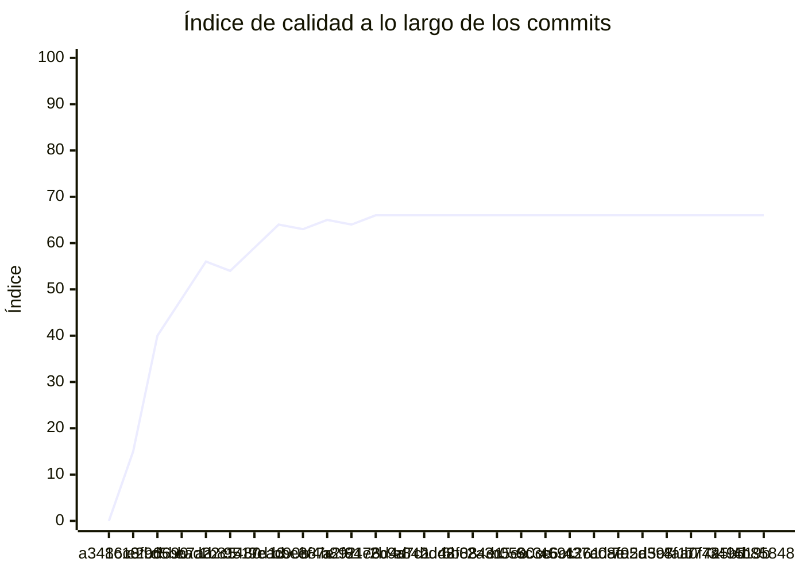

<!-- evaluacion:inicio -->
# Evaluación — prog-2-SQR/Backend-Catalogo

> Documento **generado automáticamente** por la cátedra de Programación II (UM): RepoSense + análisis de calidad de **7 dimensiones**. **No editar a mano**: se regenera en cada evaluación.
> Rama evaluada: `main`. Análisis **heurístico** (regex + métricas) + build: es una criba para orientar la revisión, **no una nota**. La **documentación** del repositorio no se evalúa.
> Generado: 2026-11-11.

## 1. Veredicto

| Aspecto | Resultado |
|---|---|
| Índice de calidad | **77/100** |
| Tipo de repositorio | `backend` |
| Build (`mvnw verify` / `gradlew check`) | OK |
| Código (LOC) | 6,291 |
| Archivos de código | 198 |
| Clases | 203 |
| Código dentro de clases (%POO) | 64% |
| Funciones fuera de clases | 0 |
| Duplicación (puerta) | 0.0% |
| Duplicación lógica | 0.0% |
| Duplicación de boilerplate | 20.0% |
| Cobertura | 100% |
| Tope duro aplicado a D1 | `POO_BAJO` → D1 ≤ 60 |

> Este informe **describe** lo que el análisis midió con los criterios ya establecidos de la materia. No es una nota.

## 2. Semáforo de aprobación

Criterios de la cátedra (`CRITERIOS-CALIDAD.md`): **Aprobar** se juega con el perfil `estandar`; **destacar**, con el `exigente` (meta de excelencia).

| Semáforo | Resultado |
|---|---|
| Aprobar (`estandar`) | **cumple** — 8/11 |
| Destacar (`exigente`) | **no cumple** — 6/11 |

**Para destacar, falta cumplir:** SOLID; POO

## 3. Autoría (RepoSense)

| Autor | Commits | Código (LOC) | Tests (LOC) | Docs (LOC) | Días activos | % del código |
|---|---:|---:|---:|---:|---:|---:|
| Santiago Quiroga Rivarossa | 87 | 3,579 | 4,781 | 722 | 17 | 100% |

> _El LOC de autoría lo calcula RepoSense sobre el historial y puede diferir del LOC de código del análisis (que mira el estado de `main`)._

## 4. Dimensiones evaluadas

Cada dimensión indica **qué mide**, **por qué importa** y **tu resultado**. Cuando el puntaje queda por debajo de la referencia, se agregan preguntas para **investigar la causa** (no hay recetas).

| Dimensión | Peso | Puntaje |
|:--|--:|--:|
| **D1** Diseño OO, SOLID y patrones (20%) | 20% | 3 |
| **D2** Arquitectura hexagonal — backend (15%) | 15% | 100 |
| **D3** Frontend KMP: MVVM y buenas prácticas (10%) | 10% | N/A |
| **D4** Integración y contrato (10%) | 10% | 90 |
| **D5** Seguridad y robustez (10%) | 10% | 100 |
| **D6** Pruebas y cobertura (20%) | 20% | 100 |
| **D7** Proceso y entrega (15%) | 15% | 100 |

### D1. Diseño OO, SOLID y patrones (20%)

- **Qué mide:** Métricas orientadas a objetos (clases, métodos, campos, cohesión, acoplamiento, herencia) y proxies de SOLID, más patrones de diseño.
- **Por qué importa:** El eje de la materia es el buen uso de la POO y su arquitectura: un diseño con clases claras y poco acopladas es más fácil de entender, probar y cambiar.
- **Tu resultado:** **3/100**
- **Para investigar la causa:**
    - ¿Se pensó el modelo de clases antes de codificar o se agrupó después?
    - ¿Qué clases concentran muchas responsabilidades a la vez?
    - ¿Los colaboradores llegan como parámetros o se crean por dentro?

### D2. Arquitectura hexagonal — backend (15%)

- **Qué mide:** Separación en capas (dominio, puertos de entrada/salida, adaptadores) y dirección de las dependencias del backend.
- **Por qué importa:** Aislar el dominio de la infraestructura permite cambiar la base de datos, el framework o el transporte sin tocar las reglas de negocio.
- **Tu resultado:** **100/100**

### D4. Integración y contrato (10%)

- **Qué mide:** Cumplimiento del contrato de integración de la cátedra (formato de errores, paginación, autenticación, endpoints esperados).
- **Por qué importa:** Los servicios deben poder integrarse entre sí y con la app sin sorpresas; el contrato es lo que hacen cumplir las pruebas de integración.
- **Tu resultado:** **90/100**

### D5. Seguridad y robustez (10%)

- **Qué mide:** Credenciales embebidas, consultas SQL por concatenación, y presencia de config de entorno; aislamiento de secretos.
- **Por qué importa:** Un secreto en el repositorio o una consulta construida por concatenación son riesgos concretos, no hipotéticos.
- **Tu resultado:** **100/100**

### D6. Pruebas y cobertura (20%)

- **Qué mide:** Cantidad y resultado de pruebas y cobertura de línea (JaCoCo/Kover, Surefire/Failsafe) cuando hay build.
- **Por qué importa:** Las pruebas son la red de seguridad para refactorizar e integrar; la cobertura acota las zonas sin verificar.
- **Tu resultado:** **100/100**

### D7. Proceso y entrega (15%)

- **Qué mide:** Artefactos verificables de proceso/entrega: `compose`, `.env.example`, CI (`.github/workflows/`), `CODEOWNERS` y wrapper de build (`mvnw`/`gradlew`). **No** puntúa documentación.
- **Por qué importa:** Un proyecto que compila, se levanta y se valida solo es más fácil de revisar y de integrar en equipo.
- **Tu resultado:** **100/100**

## 5. Señales detectadas

El análisis encontró las siguientes señales (archivo, sin número de línea a propósito):

**DIP/concretos** (52)
- clase 'ProfessionalSpecifications' muy acoplada (CBO=13) — `src/main/java/ar/edu/um/prog2/quiroga/catalogo/professional/infrastructure/persistence/specification/ProfessionalSpecifications.java`
- clase 'JpaProfessionalRepositoryAdapter' muy acoplada (CBO=12) — `src/main/java/ar/edu/um/prog2/quiroga/catalogo/professional/infrastructure/persistence/adapter/JpaProfessionalRepositoryAdapter.java`
- clase 'ProfessionalController' muy acoplada (CBO=13) — `src/main/java/ar/edu/um/prog2/quiroga/catalogo/professional/infrastructure/web/controller/ProfessionalController.java`
- clase 'ProfessionalService' muy acoplada (CBO=8) — `src/main/java/ar/edu/um/prog2/quiroga/catalogo/professional/application/service/ProfessionalService.java`
- clase 'RedisCatalogChangeFeedAdapter' muy acoplada (CBO=35) — `src/main/java/ar/edu/um/prog2/quiroga/catalogo/sync/infrastructure/redis/adapter/RedisCatalogChangeFeedAdapter.java`
- clase 'RedisCatalogChangeFeedAdapter' instancia 4 concretos (CBO=35) — `src/main/java/ar/edu/um/prog2/quiroga/catalogo/sync/infrastructure/redis/adapter/RedisCatalogChangeFeedAdapter.java`
- clase 'CatalogSnapshotDtoMapper' muy acoplada (CBO=10) — `src/main/java/ar/edu/um/prog2/quiroga/catalogo/sync/infrastructure/client/mapper/CatalogSnapshotDtoMapper.java`
- clase 'CatedraSnapshotClientAdapter' muy acoplada (CBO=11) — `src/main/java/ar/edu/um/prog2/quiroga/catalogo/sync/infrastructure/client/adapter/CatedraSnapshotClientAdapter.java`
- clase 'CatalogSlicesWriterAdapter' muy acoplada (CBO=8) — `src/main/java/ar/edu/um/prog2/quiroga/catalogo/sync/infrastructure/catalog/adapter/CatalogSlicesWriterAdapter.java`
- clase 'SyncService' muy acoplada (CBO=8) — `src/main/java/ar/edu/um/prog2/quiroga/catalogo/sync/application/service/SyncService.java`
- clase 'SynchronizeChangesUseCaseImpl' muy acoplada (CBO=17) — `src/main/java/ar/edu/um/prog2/quiroga/catalogo/sync/application/usecases/SynchronizeChangesUseCaseImpl.java`
- clase 'GetSyncStatusUseCaseImpl' muy acoplada (CBO=12) — `src/main/java/ar/edu/um/prog2/quiroga/catalogo/sync/application/usecases/GetSyncStatusUseCaseImpl.java`
- clase 'SyncHealth' muy acoplada (CBO=8) — `src/main/java/ar/edu/um/prog2/quiroga/catalogo/sync/domain/model/SyncHealth.java`
- clase 'SyncStatus' muy acoplada (CBO=8) — `src/main/java/ar/edu/um/prog2/quiroga/catalogo/sync/domain/model/SyncStatus.java`
- clase 'CatedraClientConfig' muy acoplada (CBO=17) — `src/main/java/ar/edu/um/prog2/quiroga/catalogo/config/CatedraClientConfig.java`
- clase 'JwtConfig' muy acoplada (CBO=15) — `src/main/java/ar/edu/um/prog2/quiroga/catalogo/shared/security/JwtConfig.java`
- clase 'JwtConfig' instancia 5 concretos (CBO=15) — `src/main/java/ar/edu/um/prog2/quiroga/catalogo/shared/security/JwtConfig.java`
- clase 'SecurityConfig' muy acoplada (CBO=8) — `src/main/java/ar/edu/um/prog2/quiroga/catalogo/shared/security/SecurityConfig.java`
- clase 'GlobalExceptionHandler' muy acoplada (CBO=18) — `src/main/java/ar/edu/um/prog2/quiroga/catalogo/shared/web/GlobalExceptionHandler.java`
- clase 'WeeklySchedule' muy acoplada (CBO=8) — `src/main/java/ar/edu/um/prog2/quiroga/catalogo/schedule/domain/model/WeeklySchedule.java`
- clase 'JpaProfessionalRepositoryAdapterTest' muy acoplada (CBO=17) — `src/test/java/ar/edu/um/prog2/quiroga/catalogo/professional/infrastructure/persistence/adapter/JpaProfessionalRepositoryAdapterTest.java`
- clase 'ProfessionalControllerTest' muy acoplada (CBO=15) — `src/test/java/ar/edu/um/prog2/quiroga/catalogo/professional/infrastructure/web/controller/ProfessionalControllerTest.java`
- clase 'ProfessionalServiceTest' muy acoplada (CBO=11) — `src/test/java/ar/edu/um/prog2/quiroga/catalogo/professional/application/service/ProfessionalServiceTest.java`
- clase 'SearchProfessionalsUseCaseImplTest' muy acoplada (CBO=8) — `src/test/java/ar/edu/um/prog2/quiroga/catalogo/professional/application/usecases/SearchProfessionalsUseCaseImplTest.java`
- clase 'SnapshotSynchronizationTest' muy acoplada (CBO=11) — `src/test/java/ar/edu/um/prog2/quiroga/catalogo/sync/SnapshotSynchronizationTest.java`
- clase 'IncrementalSynchronizationTest' muy acoplada (CBO=25) — `src/test/java/ar/edu/um/prog2/quiroga/catalogo/sync/IncrementalSynchronizationTest.java`
- clase 'CatalogUpdatedKafkaTest' muy acoplada (CBO=31) — `src/test/java/ar/edu/um/prog2/quiroga/catalogo/sync/CatalogUpdatedKafkaTest.java`
- clase 'CatalogUpdatedKafkaTest' instancia 3 concretos (CBO=31) — `src/test/java/ar/edu/um/prog2/quiroga/catalogo/sync/CatalogUpdatedKafkaTest.java`
- clase 'KafkaConfiguration' muy acoplada (CBO=9) — `src/test/java/ar/edu/um/prog2/quiroga/catalogo/sync/CatalogUpdatedKafkaTest.java`
- clase 'SyncFixtures' muy acoplada (CBO=12) — `src/test/java/ar/edu/um/prog2/quiroga/catalogo/sync/support/SyncFixtures.java`
- clase 'CatalogRedisHealthIndicatorTest' muy acoplada (CBO=10) — `src/test/java/ar/edu/um/prog2/quiroga/catalogo/sync/infrastructure/redis/health/CatalogRedisHealthIndicatorTest.java`
- clase 'RedisCatalogChangeFeedAdapterTest' muy acoplada (CBO=26) — `src/test/java/ar/edu/um/prog2/quiroga/catalogo/sync/infrastructure/redis/adapter/RedisCatalogChangeFeedAdapterTest.java`
- clase 'CatalogUpdatedListenerTest' muy acoplada (CBO=12) — `src/test/java/ar/edu/um/prog2/quiroga/catalogo/sync/infrastructure/messaging/listener/CatalogUpdatedListenerTest.java`
- clase 'CatalogUpdatedListenerTest' instancia 3 concretos (CBO=12) — `src/test/java/ar/edu/um/prog2/quiroga/catalogo/sync/infrastructure/messaging/listener/CatalogUpdatedListenerTest.java`
- clase 'CatalogSnapshotDtoMapperTest' muy acoplada (CBO=15) — `src/test/java/ar/edu/um/prog2/quiroga/catalogo/sync/infrastructure/client/mapper/CatalogSnapshotDtoMapperTest.java`
- clase 'CatedraSnapshotClientAdapterTest' muy acoplada (CBO=26) — `src/test/java/ar/edu/um/prog2/quiroga/catalogo/sync/infrastructure/client/adapter/CatedraSnapshotClientAdapterTest.java`
- clase 'CatalogSlicesWriterAdapterTest' muy acoplada (CBO=9) — `src/test/java/ar/edu/um/prog2/quiroga/catalogo/sync/infrastructure/catalog/adapter/CatalogSlicesWriterAdapterTest.java`
- clase 'SyncStatusControllerTest' muy acoplada (CBO=8) — `src/test/java/ar/edu/um/prog2/quiroga/catalogo/sync/infrastructure/web/controller/SyncStatusControllerTest.java`
- clase 'SyncServiceTest' muy acoplada (CBO=9) — `src/test/java/ar/edu/um/prog2/quiroga/catalogo/sync/application/service/SyncServiceTest.java`
- clase 'SynchronizeChangesUseCaseImplTest' muy acoplada (CBO=16) — `src/test/java/ar/edu/um/prog2/quiroga/catalogo/sync/application/usecases/SynchronizeChangesUseCaseImplTest.java`
- clase 'GetSyncStatusUseCaseImplTest' muy acoplada (CBO=17) — `src/test/java/ar/edu/um/prog2/quiroga/catalogo/sync/application/usecases/GetSyncStatusUseCaseImplTest.java`
- clase 'GetSyncStatusUseCaseImplTest' instancia 3 concretos (CBO=17) — `src/test/java/ar/edu/um/prog2/quiroga/catalogo/sync/application/usecases/GetSyncStatusUseCaseImplTest.java`
- clase 'SynchronizeSnapshotUseCaseImplTest' muy acoplada (CBO=8) — `src/test/java/ar/edu/um/prog2/quiroga/catalogo/sync/application/usecases/SynchronizeSnapshotUseCaseImplTest.java`
- clase 'SyncStatusTest' muy acoplada (CBO=10) — `src/test/java/ar/edu/um/prog2/quiroga/catalogo/sync/domain/model/SyncStatusTest.java`
- clase 'CategoryControllerTest' muy acoplada (CBO=9) — `src/test/java/ar/edu/um/prog2/quiroga/catalogo/category/infrastructure/web/controller/CategoryControllerTest.java`
- clase 'CatedraClientConfigTest' muy acoplada (CBO=21) — `src/test/java/ar/edu/um/prog2/quiroga/catalogo/config/CatedraClientConfigTest.java`
- clase 'CatalogSecurityTest' muy acoplada (CBO=15) — `src/test/java/ar/edu/um/prog2/quiroga/catalogo/shared/security/CatalogSecurityTest.java`
- clase 'JwtConfigTest' muy acoplada (CBO=13) — `src/test/java/ar/edu/um/prog2/quiroga/catalogo/shared/security/JwtConfigTest.java`
- clase 'JwtConfigTest' instancia 3 concretos (CBO=13) — `src/test/java/ar/edu/um/prog2/quiroga/catalogo/shared/security/JwtConfigTest.java`
- clase 'WeeklyScheduleFixtures' muy acoplada (CBO=9) — `src/test/java/ar/edu/um/prog2/quiroga/catalogo/schedule/support/WeeklyScheduleFixtures.java`
- clase 'WeeklyScheduleControllerTest' muy acoplada (CBO=9) — `src/test/java/ar/edu/um/prog2/quiroga/catalogo/schedule/infrastructure/web/controller/WeeklyScheduleControllerTest.java`
- clase 'WeeklyScheduleServiceTest' muy acoplada (CBO=8) — `src/test/java/ar/edu/um/prog2/quiroga/catalogo/schedule/application/service/WeeklyScheduleServiceTest.java`

**SRP/responsabilidad** (52)
- método 'ProfessionalSpecifications.matching' con complejidad 9 — `src/main/java/ar/edu/um/prog2/quiroga/catalogo/professional/infrastructure/persistence/specification/ProfessionalSpecifications.java`
- clase 'ProfessionalEntity' sin métodos (7 campos): solo datos — `src/main/java/ar/edu/um/prog2/quiroga/catalogo/professional/infrastructure/persistence/entity/ProfessionalEntity.java`
- clase 'ProfessionalResponse' sin métodos (5 campos): solo datos — `src/main/java/ar/edu/um/prog2/quiroga/catalogo/professional/infrastructure/web/dto/ProfessionalResponse.java`
- clase 'ProfessionalPageResponse' sin métodos (5 campos): solo datos — `src/main/java/ar/edu/um/prog2/quiroga/catalogo/professional/infrastructure/web/dto/ProfessionalPageResponse.java`
- clase 'ProfessionalService' con baja cohesión (20%) — `src/main/java/ar/edu/um/prog2/quiroga/catalogo/professional/application/service/ProfessionalService.java`
- clase 'Professional' sin métodos (7 campos): solo datos — `src/main/java/ar/edu/um/prog2/quiroga/catalogo/professional/domain/model/Professional.java`
- clase 'RedisCatalogChangeFeedAdapter' grande (LOC=82, métodos=11, campos=4) — `src/main/java/ar/edu/um/prog2/quiroga/catalogo/sync/infrastructure/redis/adapter/RedisCatalogChangeFeedAdapter.java`
- clase 'RedisCatalogChangeFeedAdapter' con baja cohesión (13%) — `src/main/java/ar/edu/um/prog2/quiroga/catalogo/sync/infrastructure/redis/adapter/RedisCatalogChangeFeedAdapter.java`
- clase 'CatalogChangesMessage' sin métodos (5 campos): solo datos — `src/main/java/ar/edu/um/prog2/quiroga/catalogo/sync/infrastructure/redis/dto/CatalogChangesMessage.java`
- clase 'ChangedIds' sin métodos (3 campos): solo datos — `src/main/java/ar/edu/um/prog2/quiroga/catalogo/sync/infrastructure/redis/dto/CatalogChangesMessage.java`
- clase 'SyncStateEntity' sin métodos (4 campos): solo datos — `src/main/java/ar/edu/um/prog2/quiroga/catalogo/sync/infrastructure/persistence/entity/SyncStateEntity.java`
- clase 'ProcessedEventEntity' sin métodos (3 campos): solo datos — `src/main/java/ar/edu/um/prog2/quiroga/catalogo/sync/infrastructure/persistence/entity/ProcessedEventEntity.java`
- clase 'CatalogUpdatedListener' con baja cohesión (10%) — `src/main/java/ar/edu/um/prog2/quiroga/catalogo/sync/infrastructure/messaging/listener/CatalogUpdatedListener.java`
- clase 'CatalogUpdatedMessage' sin métodos (6 campos): solo datos — `src/main/java/ar/edu/um/prog2/quiroga/catalogo/sync/infrastructure/messaging/dto/CatalogUpdatedMessage.java`
- clase 'CatalogWeeklyScheduleResponse' grande (LOC=11, métodos=0, campos=9) — `src/main/java/ar/edu/um/prog2/quiroga/catalogo/sync/infrastructure/client/dto/CatalogWeeklyScheduleResponse.java`
- clase 'CatalogWeeklyScheduleResponse' sin métodos (9 campos): solo datos — `src/main/java/ar/edu/um/prog2/quiroga/catalogo/sync/infrastructure/client/dto/CatalogWeeklyScheduleResponse.java`
- clase 'CatalogProfessionalResponse' sin métodos (7 campos): solo datos — `src/main/java/ar/edu/um/prog2/quiroga/catalogo/sync/infrastructure/client/dto/CatalogProfessionalResponse.java`
- clase 'CatalogCategoryResponse' sin métodos (6 campos): solo datos — `src/main/java/ar/edu/um/prog2/quiroga/catalogo/sync/infrastructure/client/dto/CatalogCategoryResponse.java`
- clase 'CatalogSnapshotResponse' sin métodos (5 campos): solo datos — `src/main/java/ar/edu/um/prog2/quiroga/catalogo/sync/infrastructure/client/dto/CatalogSnapshotResponse.java`
- clase 'SyncStatusResponse' sin métodos (7 campos): solo datos — `src/main/java/ar/edu/um/prog2/quiroga/catalogo/sync/infrastructure/web/dto/SyncStatusResponse.java`
- clase 'SyncService' con baja cohesión (0%) — `src/main/java/ar/edu/um/prog2/quiroga/catalogo/sync/application/service/SyncService.java`
- clase 'SynchronizeChangesUseCaseImpl' con baja cohesión (33%) — `src/main/java/ar/edu/um/prog2/quiroga/catalogo/sync/application/usecases/SynchronizeChangesUseCaseImpl.java`
- clase 'CatalogProfessional' sin métodos (7 campos): solo datos — `src/main/java/ar/edu/um/prog2/quiroga/catalogo/sync/domain/model/CatalogProfessional.java`
- clase 'CatalogWeeklySchedule' grande (LOC=11, métodos=0, campos=9) — `src/main/java/ar/edu/um/prog2/quiroga/catalogo/sync/domain/model/CatalogWeeklySchedule.java`
- clase 'CatalogWeeklySchedule' sin métodos (9 campos): solo datos — `src/main/java/ar/edu/um/prog2/quiroga/catalogo/sync/domain/model/CatalogWeeklySchedule.java`
- clase 'SyncActivity' sin métodos (3 campos): solo datos — `src/main/java/ar/edu/um/prog2/quiroga/catalogo/sync/domain/model/SyncActivity.java`
- clase 'CatalogSnapshot' sin métodos (5 campos): solo datos — `src/main/java/ar/edu/um/prog2/quiroga/catalogo/sync/domain/model/CatalogSnapshot.java`
- clase 'CatalogChanges' sin métodos (4 campos): solo datos — `src/main/java/ar/edu/um/prog2/quiroga/catalogo/sync/domain/model/CatalogChanges.java`
- clase 'CatalogCategory' sin métodos (6 campos): solo datos — `src/main/java/ar/edu/um/prog2/quiroga/catalogo/sync/domain/model/CatalogCategory.java`
- clase 'CatalogUpdate' sin métodos (3 campos): solo datos — `src/main/java/ar/edu/um/prog2/quiroga/catalogo/sync/domain/model/CatalogUpdate.java`
- clase 'CategoryEntity' sin métodos (6 campos): solo datos — `src/main/java/ar/edu/um/prog2/quiroga/catalogo/category/infrastructure/persistence/entity/CategoryEntity.java`
- clase 'CategoryResponse' sin métodos (4 campos): solo datos — `src/main/java/ar/edu/um/prog2/quiroga/catalogo/category/infrastructure/web/dto/CategoryResponse.java`
- clase 'CategoryService' con baja cohesión (33%) — `src/main/java/ar/edu/um/prog2/quiroga/catalogo/category/application/service/CategoryService.java`
- clase 'Category' sin métodos (6 campos): solo datos — `src/main/java/ar/edu/um/prog2/quiroga/catalogo/category/domain/model/Category.java`
- clase 'CatedraProperties' sin métodos (6 campos): solo datos — `src/main/java/ar/edu/um/prog2/quiroga/catalogo/config/CatedraProperties.java`
- clase 'JwtConfig' con baja cohesión (33%) — `src/main/java/ar/edu/um/prog2/quiroga/catalogo/shared/security/JwtConfig.java`
- clase 'WeeklyScheduleEntity' grande (LOC=21, métodos=0, campos=9) — `src/main/java/ar/edu/um/prog2/quiroga/catalogo/schedule/infrastructure/persistence/entity/WeeklyScheduleEntity.java`
- clase 'WeeklyScheduleEntity' sin métodos (9 campos): solo datos — `src/main/java/ar/edu/um/prog2/quiroga/catalogo/schedule/infrastructure/persistence/entity/WeeklyScheduleEntity.java`
- clase 'WeeklyScheduleResponse' sin métodos (7 campos): solo datos — `src/main/java/ar/edu/um/prog2/quiroga/catalogo/schedule/infrastructure/web/dto/WeeklyScheduleResponse.java`
- clase 'WeeklyScheduleService' con baja cohesión (20%) — `src/main/java/ar/edu/um/prog2/quiroga/catalogo/schedule/application/service/WeeklyScheduleService.java`
- clase 'WeeklySchedule' grande (LOC=19, métodos=1, campos=9) — `src/main/java/ar/edu/um/prog2/quiroga/catalogo/schedule/domain/model/WeeklySchedule.java`
- clase 'JpaProfessionalRepositoryAdapterTest' grande (LOC=107, métodos=13, campos=1) — `src/test/java/ar/edu/um/prog2/quiroga/catalogo/professional/infrastructure/persistence/adapter/JpaProfessionalRepositoryAdapterTest.java`
- clase 'IncrementalSynchronizationTest' con baja cohesión (27%) — `src/test/java/ar/edu/um/prog2/quiroga/catalogo/sync/IncrementalSynchronizationTest.java`
- clase 'CatalogUpdatedKafkaTest' grande (LOC=89, métodos=11, campos=6) — `src/test/java/ar/edu/um/prog2/quiroga/catalogo/sync/CatalogUpdatedKafkaTest.java`
- clase 'CatalogUpdatedKafkaTest' con baja cohesión (27%) — `src/test/java/ar/edu/um/prog2/quiroga/catalogo/sync/CatalogUpdatedKafkaTest.java`
- clase 'RedisCatalogChangeFeedAdapterTest' grande (LOC=108, métodos=13, campos=4) — `src/test/java/ar/edu/um/prog2/quiroga/catalogo/sync/infrastructure/redis/adapter/RedisCatalogChangeFeedAdapterTest.java`
- clase 'RedisCatalogChangeFeedAdapterTest' con baja cohesión (47%) — `src/test/java/ar/edu/um/prog2/quiroga/catalogo/sync/infrastructure/redis/adapter/RedisCatalogChangeFeedAdapterTest.java`
- método 'CatalogSnapshotDtoMapperTest.toDomainMapsVersionAndTheThreeCollections' de 40 líneas — `src/test/java/ar/edu/um/prog2/quiroga/catalogo/sync/infrastructure/client/mapper/CatalogSnapshotDtoMapperTest.java`
- clase 'SynchronizeChangesUseCaseImplTest' grande (LOC=105, métodos=10, campos=7) — `src/test/java/ar/edu/um/prog2/quiroga/catalogo/sync/application/usecases/SynchronizeChangesUseCaseImplTest.java`
- método 'SynchronizeChangesUseCaseImplTest.appliesEachVersionInOrderWithTheCurrentStateOfTheChangedEntities' con complejidad 9 — `src/test/java/ar/edu/um/prog2/quiroga/catalogo/sync/application/usecases/SynchronizeChangesUseCaseImplTest.java`
- clase 'CatedraClientConfigTest' grande (LOC=87, métodos=13, campos=5) — `src/test/java/ar/edu/um/prog2/quiroga/catalogo/config/CatedraClientConfigTest.java`
- clase 'CatedraClientConfigTest' con baja cohesión (42%) — `src/test/java/ar/edu/um/prog2/quiroga/catalogo/config/CatedraClientConfigTest.java`

**OCP/type-switch** (1)
- clase 'GlobalExceptionHandler' con 1 type-checks — `src/main/java/ar/edu/um/prog2/quiroga/catalogo/shared/web/GlobalExceptionHandler.java`

## 6. Evolución por commit

Métricas calculadas sobre el estado de `main` en **cada commit** (28 commits con trabajo), del primero al último. La calidad usa el perfil `exigente`; el aporte de código lo mide RepoSense. El índice puede **bajar** al crecer el proyecto: se acumulan señales.

| # | Fecha | Commit | Autor | LOC | Índice | %POO | Duplic. | Sueltas |
|---|---|---|---|---:|---:|---:|---:|---:|
| 1 | 2026-09-10 | `a341c10` | Ing. Daniel Quinteros | 0 | 0 | 0% | 0.0% | 0 |
| 2 | 2026-09-10 | `86c3f96` | Ing. Daniel Quinteros | 0 | 15 | 0% | 0.0% | 0 |
| 3 | 2026-10-16 | `e2bd690` | Santiago Quiroga Rivarossa | 18 | 40 | 56% | 0.0% | 0 |
| 4 | 2026-10-17 | `d5bb7aa` | Santiago Quiroga Rivarossa | 34 | 48 | 50% | 0.0% | 0 |
| 5 | 2026-10-18 | `ead22c5` | Santiago Quiroga Rivarossa | 262 | 56 | 55% | 0.0% | 0 |
| 6 | 2026-10-18 | `1b81480` | Santiago Quiroga Rivarossa | 335 | 54 | 54% | 0.0% | 0 |
| 7 | 2026-10-19 | `9517d13` | Santiago Quiroga Rivarossa | 617 | 59 | 61% | 0.0% | 0 |
| 8 | 2026-10-19 | `9eac90b` | Santiago Quiroga Rivarossa | 1,212 | 64 | 62% | 0.0% | 0 |
| 9 | 2026-10-22 | `bbee87e` | Santiago Quiroga Rivarossa | 1,933 | 63 | 63% | 0.0% | 0 |
| 10 | 2026-10-23 | `3f4b892` | Santiago Quiroga Rivarossa | 2,083 | 65 | 63% | 0.0% | 0 |
| 11 | 2026-10-23 | `a2f9173` | Santiago Quiroga Rivarossa | 2,605 | 64 | 64% | 0.0% | 0 |
| 12 | 2026-10-23 | `84e6d4d` | Santiago Quiroga Rivarossa | 2,771 | 66 | 64% | 0.0% | 0 |
| 13 | 2026-10-23 | `2b9a7c1` | Santiago Quiroga Rivarossa | 3,529 | 66 | 62% | 0.0% | 0 |
| 14 | 2026-10-24 | `e84bd42` | Santiago Quiroga Rivarossa | 4,025 | 66 | 63% | 0.0% | 0 |
| 15 | 2026-10-27 | `2dd8f03` | Santiago Quiroga Rivarossa | 4,396 | 66 | 64% | 0.0% | 0 |
| 16 | 2026-10-27 | `6b884e1` | Santiago Quiroga Rivarossa | 4,612 | 66 | 64% | 0.0% | 0 |
| 17 | 2026-10-27 | `2a3c5ec` | Santiago Quiroga Rivarossa | 4,992 | 66 | 64% | 0.0% | 0 |
| 18 | 2026-10-27 | `b0590ce` | Santiago Quiroga Rivarossa | 5,159 | 66 | 64% | 0.0% | 0 |
| 19 | 2026-10-28 | `6c3c6c1` | Santiago Quiroga Rivarossa | 5,733 | 66 | 64% | 0.0% | 0 |
| 20 | 2026-10-29 | `469c261` | Santiago Quiroga Rivarossa | 5,733 | 66 | 64% | 0.0% | 0 |
| 21 | 2026-10-29 | `437c08e` | Santiago Quiroga Rivarossa | 6,256 | 66 | 64% | 0.0% | 0 |
| 22 | 2026-10-29 | `adafa5d` | Santiago Quiroga Rivarossa | 6,263 | 66 | 64% | 0.0% | 0 |
| 23 | 2026-10-29 | `702a397` | Santiago Quiroga Rivarossa | 6,289 | 66 | 64% | 0.0% | 0 |
| 24 | 2026-11-02 | `d5c8f17` | Santiago Quiroga Rivarossa | 6,290 | 66 | 64% | 0.0% | 0 |
| 25 | 2026-11-02 | `4aa0f7a` | Santiago Quiroga Rivarossa | 6,290 | 66 | 64% | 0.0% | 0 |
| 26 | 2026-11-04 | `b7425bd` | Santiago Quiroga Rivarossa | 6,290 | 66 | 64% | 0.0% | 0 |
| 27 | 2026-11-04 | `349519b` | Santiago Quiroga Rivarossa | 6,290 | 66 | 64% | 0.0% | 0 |
| 28 | 2026-11-04 | `4b85848` | Santiago Quiroga Rivarossa | 6,291 | 66 | 64% | 0.0% | 0 |

---
_Informe generado por la cátedra. Las dimensiones y umbrales corresponden a `calidad.py` (perfil `exigente`); el semáforo, a `CRITERIOS-CALIDAD.md`. La documentación del repositorio no se evalúa. Ante dudas, revisá el archivo señalado._
<!-- evaluacion:fin -->
