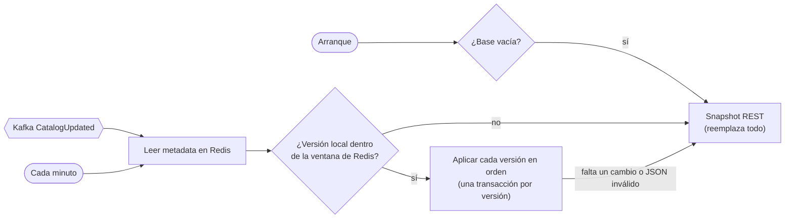
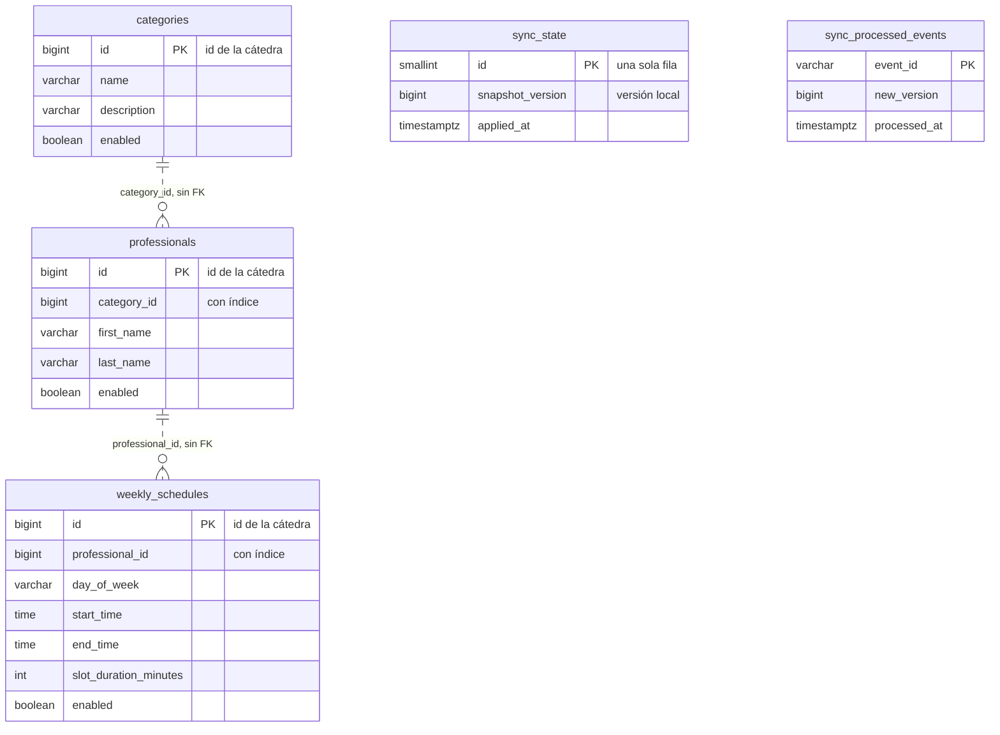

# SPEC: Backend-Catalogo

Qué hace el servicio, con qué contrato y con qué datos. El cómo se construyó está en [PLAN.md](PLAN.md), y el detalle de cada tarea, en [TASKS.md](TASKS.md).

## Propósito

Servicio de **catálogo y sincronización** de la app de turnos. Mantiene una copia local de las categorías, los profesionales y los horarios semanales que publica la cátedra, la sincroniza con un snapshot completo y con cambios incrementales, y la expone para las búsquedas de la app y las consultas del servicio de turnos.

Es dueño exclusivo de su base de datos (enunciado §3). Las búsquedas se resuelven siempre con la copia local: si la cátedra no responde, el catálogo sigue atendiendo con lo último que sincronizó.

## Requisitos que cubre

Enunciado §5:

| Punto | Requisito | Dónde |
|---|---|---|
| 3 | Autenticar la cuenta de integración y usar su configuración | `config` (JWT técnico, Redis y Kafka por variables de entorno) |
| 4 | Obtener y guardar localmente un snapshot completo | `sync` |
| 5 | Mantener el catálogo actualizado con Kafka y Redis | `sync` |
| 6 | Detectar que no se puede seguir incrementalmente y reconstruir | `sync` |
| 7 | Buscar y filtrar profesionales con la copia local | `professional` |
| 15 | Informar errores de integración sin corromper el estado local | `sync` (transacción por versión, estado de la sincronización) |

## Casos de uso

Los mismos códigos que en [Documentacion/casos-de-uso/catalogo.md](https://github.com/prog-2-SQR/Documentacion/blob/main/casos-de-uso/catalogo.md), donde está el detalle de cada uno.

| Código | Caso de uso | Disparador |
|---|---|---|
| CU-CAT-01 | Inicializar o reconstruir el catálogo desde el snapshot | Al arrancar con la base vacía, o ante una discontinuidad |
| CU-CAT-02 | Aplicar los cambios incrementales | Kafka `CatalogUpdated`, o el chequeo periódico de Redis (cada minuto) |
| CU-CAT-03 | Detectar una discontinuidad y resincronizar | La versión local quedó fuera de la ventana de Redis, o falta un cambio |
| CU-CAT-04 | Buscar profesionales con filtros locales | `GET /api/professionals/search` |
| CU-CAT-05 | Darle a Turnos el profesional y sus horarios vigentes | `GET /api/professionals/{id}`, `GET /api/schedules?professionalId` |
| CU-CAT-06 | Informar el estado de la sincronización | `GET /api/sync/status` |

## API

Todas las rutas `/api/**` piden `Authorization: Bearer <id_token>`, el JWT que emite el servicio de turnos. Sin token o con uno inválido responden `401`. Los errores salen como `application/problem+json` con un `code` (anexo §13).

| Método y ruta | Respuesta | Errores |
|---|---|---|
| `GET /api/categories` | `200`, lista de categorías | — |
| `GET /api/categories/{id}` | `200`, una categoría | `404 CATEGORY_NOT_FOUND` |
| `GET /api/professionals` | `200`, lista de profesionales | — |
| `GET /api/professionals/search?categoryId&name&enabled&dayOfWeek&page&size` | `200 {content, page, size, totalElements, totalPages}` | `400 VALIDATION_ERROR` (`name` hasta 100 caracteres, `size` de 1 a 100) |
| `GET /api/professionals/{id}` | `200`, un profesional | `404 PROFESSIONAL_NOT_FOUND` |
| `GET /api/schedules?professionalId` | `200`, horarios semanales (todos o los de un profesional) | — |
| `GET /api/schedules/{id}` | `200`, un horario | `404 WEEKLY_SCHEDULE_NOT_FOUND` |
| `GET /api/sync/status` | `200 {health, localVersion, appliedAt, publishedVersion, lastSuccessAt, lastFailureAt, lastFailureMessage}` | — |
| `GET /actuator/health`, `/v3/api-docs`, `/swagger-ui.html` | Públicos | — |

**Filtros de la búsqueda** (enunciado §5 punto 7 y §11): todos son opcionales y se combinan.
- `categoryId`: profesionales de esa categoría.
- `name`: el texto aparece en el nombre completo ("nombre apellido"), sin distinguir mayúsculas. `%` y `_` se buscan como texto, no como comodines.
- `enabled`: habilitados o no.
- `dayOfWeek`: atienden ese día (`MONDAY`…), según sus horarios semanales habilitados (ADR 0005).

El contrato que usa Turnos está en [Documentacion/contratos/turnos-catalogo.md](https://github.com/prog-2-SQR/Documentacion/blob/main/contratos/turnos-catalogo.md).

## Sincronización

Reglas (detalle en el [ADR 0006](adr/0006-sincronizacion-completa-e-incremental.md) y en [Documentacion/diagramas/sincronizacion.md](https://github.com/prog-2-SQR/Documentacion/blob/main/diagramas/sincronizacion.md)):
- **La versión local solo avanza cuando la versión entera quedó aplicada**: cada versión es una transacción. Si algo falla, se deshace esa versión y se reintenta.
- **Kafka solo avisa.** Los datos salen de Redis o del snapshot. Un aviso perdido no importa, porque el siguiente aviso o el chequeo periódico recorren todas las versiones pendientes.
- **Idempotencia**: un `CatalogUpdated` con un `eventId` ya procesado no se vuelve a procesar, y una versión ya aplicada no se aplica de nuevo.
- **Discontinuidad**: si la versión local es menor que `oldestAvailableVersion`, o falta `changes:{v}` en Redis, se reconstruye con el snapshot.

## Modelo de datos

Base PostgreSQL propia (`catalogo`), con el esquema creado por Liquibase (`src/main/resources/db/changelog/`, un archivo por slice).

**Propiedad de los datos:**
- La **fuente de verdad del catálogo es la cátedra**. Este servicio guarda una copia y nunca la modifica por su cuenta: solo la cambia la sincronización.
- Los ids son los de la cátedra (sin `@GeneratedValue`), así un cambio incremental actualiza la misma fila.
- Las relaciones entre slices son **referencias por id, sin FK** ([ADR 0003](adr/0003-referencias-entre-slices-por-id.md)): cada slice es dueño de su tabla, y el snapshot reemplaza todo en una sola transacción.
- Ningún otro servicio lee estas tablas. Turnos consulta por la API, con el JWT del usuario.
- Las tablas de cada slice tienen además `created_at` y `updated_at`.

## Requisitos no funcionales

- **Seguridad** ([ADR 0007](adr/0007-validacion-del-jwt-de-los-usuarios.md)): solo valida el JWT que emite Turnos, con el secreto compartido. El JWT técnico de la cátedra se usa solo hacia la cátedra, y todos los secretos llegan por variables de entorno.
- **Resiliencia**: timeouts (5 s de conexión y 10 s de lectura) y reintentos con espera creciente hacia la cátedra. Si la cátedra no responde, se conserva la copia actual y el error queda en `GET /api/sync/status`.
- **Pruebas**: unitarias de cada caso de uso, de controllers con MockMvc, y de integración con Testcontainers (PostgreSQL, Redis y Kafka) y WireMock (API de la cátedra). Cobertura con JaCoCo, y análisis con SonarQube Cloud en el CI.
